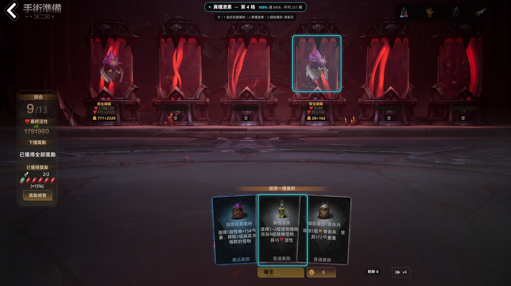
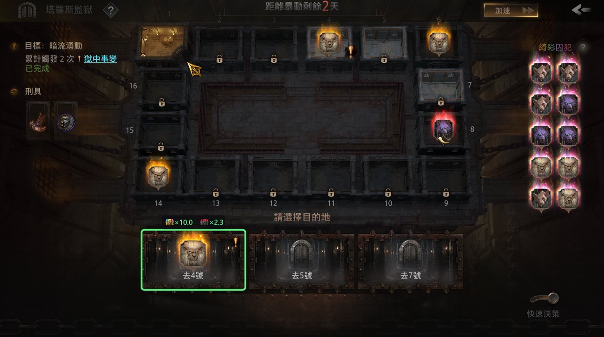
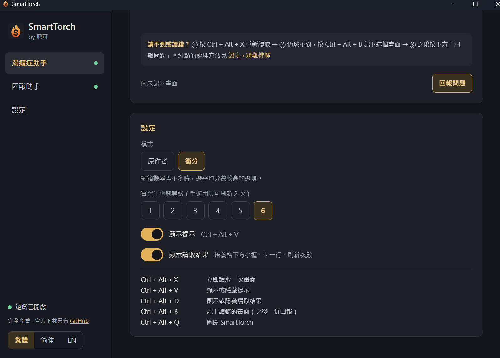

# SmartTorch

**火炬之光：無限 的免費輔助工具箱 · A free helper toolbox for Torchlight: Infinite**

> **完全免費。官方下載只有本頁的 [Releases](https://github.com/lauhinsnsd-dotcom/SmartTorch/releases/latest)。如果你是付費取得的，你被騙了。**
> **Free. The only official download is this project's [Releases](https://github.com/lauhinsnsd-dotcom/SmartTorch/releases/latest). If you paid for it, you were scammed.**

非官方玩家自製工具，與遊戲開發商、營運商無關。它只讀取遊戲畫面和遊戲日誌，**不會替你點擊或操作遊戲，也不讀取遊戲記憶體**，每一步都由你自己決定。是否使用第三方工具、是否違反遊戲條款，請自行判斷。

An unofficial, player-made tool, not affiliated with the game's makers. It only reads the game's picture and its log: **it never clicks or plays for you and never reads the game's memory**. Every move is yours. Whether to use third-party tools is your call.

| 囚獸 · Tartarus | 主視窗 · Main window |
|---|---|
|  |  |

## 工具 · Tools

| | 中文 | English |
|---|---|---|
| **渴癮症助手 · Vorax helper** | 「手術準備」畫面標示建議的卡牌與培養槽、這一步達到 840k（彩箱）的機率，並在培養槽下方顯示讀到的內容，一眼核對。支援繁體、簡體、英文客戶端。 | Surgical Preparation: marks the card and tanks to pick and the odds of reaching 840k, with what was read under each tank to check at a glance. Traditional Chinese, Simplified Chinese and English clients. |
| **囚獸助手 · Tartarus helper** | glcoder 的 [Tartarus Solver](https://github.com/glcoder/TartarusSolver)：自行下載後，SmartTorch 負責啟動、收起它的視窗、顯示統計。 | glcoder's [Tartarus Solver](https://github.com/glcoder/TartarusSolver): download it yourself; SmartTorch starts it, keeps its window out of the way and shows its statistics. |
| **易火 · ETor** | 其他作者的收益統計工具「易火 ETor」的啟動器：自行安裝後，可在 SmartTorch 開啟它，或開遊戲時自動開啟。SmartTorch 不會修改或讀取它的資料。 | A launcher for ETor, another author's income tracker: install it yourself, then open it from SmartTorch or with the game. SmartTorch neither changes nor reads its data. |
| **流派碼 · Build codes** | 儲存自己常用的流派碼，按「複製」後到遊戲裡貼上。 | Keep the build codes you use; Copy one and paste it in the game. |

一個主視窗、右下角一個圖示：開遊戲時工具自動啟動（每個工具可各自設定），關遊戲時自動停止。介面有繁體、简体、English 三種。

One main window and one tray icon: the tools start with the game (each can be set on its own) and stop when it closes. The interface is in Traditional Chinese, Simplified Chinese or English.

## 下載與使用 · Download and use

1. 到 [Releases](https://github.com/lauhinsnsd-dotcom/SmartTorch/releases/latest) 下載 `SmartTorch-版本.zip`，解壓縮後點兩下 `SmartTorch.exe`。
   Download `SmartTorch-<version>.zip` from [Releases](https://github.com/lauhinsnsd-dotcom/SmartTorch/releases/latest), unpack it and run `SmartTorch.exe`.
2. 第一次開啟會出現教學：在遊戲中開啟日誌（Esc →「帳號相關」→「開啟日誌」，再登出登入）、使用無邊框或視窗模式、選擇實習生雪莉等級。
   The first start walks you through it: turn on the game's log (Esc → Account Related → Enable Log, then log in again), play borderless or windowed, set your Intern Shelley level.
3. 之後只要開遊戲，提示就會出現在遊戲畫面上。
   Then just play: the hints show over the game.

第一次執行時 Windows 可能顯示「Windows 已保護您的電腦」（程式沒有數位簽章），請點「其他資訊」→「仍要執行」。有新版本時 SmartTorch 會提示，在主視窗「設定」按「立即更新」即可。

The first time, Windows may show "Windows protected your PC" (the program isn't code-signed): click More info → Run anyway. SmartTorch tells you when a new version is out: Settings → Update now.

### 解析度 · Resolution

| 客戶端 · Client | 解析度 · Resolution |
|---|---|
| 繁體／簡體中文 · Chinese | 2560×1440、3840×2160 已測試；其他解析度可能讀不準 · tested at 2560×1440 and 3840×2160; others may be misread |
| English | 與原作者相同 · as the original Vorax solver reads it |

請使用無邊框或視窗模式，不要用獨佔全螢幕。Play borderless or windowed, not in exclusive full screen.

## 渴癮症助手的兩種模式 · The Vorax helper's two modes

- **原作者 · Upstream's**（預設 · default）：只追求戰前達到 840k（彩箱）的機率。Only the odds of reaching 840k before the battle count.
- **衝分 · Push score**：彩箱機率相差 3% 以內時，選平均分數較高的選項。When the odds of 840k are within 3%, picks the higher average score.

電腦模擬（同一批 2,000 局）· Simulated, the same 2,000 games:

| | 原作者 · Upstream's | 衝分 · Push score |
|---|---|---|
| 達 840k · Reached 840k | 69.8% | **74.2%** |
| 達 1.12M · Reached 1.12M | 32.5% | 52.4% |
| 平均分數 · Mean score | 1,036k | 1,332k |
| 低於 50 萬 · Below 500k | 8.3% | 11.4% |

衝分模式平均較高，代價是翻車時分數可能較低。實戰表現請看「對局紀錄」的統計。Push score does better on average, at the cost of more low runs. See your own results in Your runs.

## 讀錯時 · When something is misread

1. 按 **Ctrl + Alt + X** 重新讀取。Press **Ctrl + Alt + X** to read again.
2. 仍然不對：按 **Ctrl + Alt + B** 記下這個畫面（可記好幾個）。Still wrong: **Ctrl + Alt + B** sets the picture aside (as many as you like).
3. 之後在主視窗按「**回報問題**」：桌面會出現 `SmartTorch-report-日期.zip`，並開啟回報頁，把 zip 拖進去即可。Later, press **Report a problem** in the main window: `SmartTorch-report-<time>.zip` appears on the desktop and the report page opens; drag the zip into it.

| 快捷鍵 · Hotkey | |
|---|---|
| Ctrl + Alt + X | 立即讀取 · Read the board now |
| Ctrl + Alt + V | 顯示／隱藏提示 · Show or hide the hints |
| Ctrl + Alt + D | 顯示／隱藏讀取結果 · Show or hide what was read |
| Ctrl + Alt + B | 記下讀錯的畫面 · Set a misread picture aside |
| Ctrl + Alt + Q | 關閉 SmartTorch · Quit |

## 版本紀錄 · Changelog

見 [CHANGELOG.md](CHANGELOG.md)。See [CHANGELOG.md](CHANGELOG.md).

<b>編譯 · Building</b>（開發者用 · for developers）

Windows：點兩下 `build-windows.bat`（第一次會自動安裝 Rust 與建置工具）。Run `build-windows.bat` (it installs Rust and the build tools the first time). Linux（計算與讀圖的測試 · the solver and reader tests）：`cargo test --release --workspace`。

## 致謝與授權 · Credits and licence

- **渴癮症助手 · Vorax helper**：計算與讀取基於 DinoRaos 的 [vorax-solver-rs](https://github.com/DinoRaos/vorax-solver-rs)（MIT，[原說明 · its README](docs/UPSTREAM-README.md)），其前身為 tidewarden 的 Vorax Solver（2026-10-22 版，MIT）與 Moebing 的 [渴癮症模擬器](https://github.com/Moebing/Torchlight-Infinite-SS11-Vorax-simulator)（MIT）。The solver and the screen reader are DinoRaos's, from tidewarden's Vorax Solver (its 2026-10-22 MIT version) and Moebing's simulator (MIT).
- **囚獸助手 · Tartarus helper**：glcoder 的 [Tartarus Solver](https://github.com/glcoder/TartarusSolver)（MIT），原樣使用、不隨附。glcoder's Tartarus Solver (MIT), used as it is and not bundled.
- 中文卡名：Moebing 的國服模擬器、OpenCC，以及繁中客戶端畫面。Chinese card names: Moebing's simulator, OpenCC and the Traditional Chinese client.
- 字型 · Fonts：Noto Sans TC／SC（SIL Open Font License 1.1）。
- 中文支援、SmartTorch 介面與工具箱由**肥可**製作。Chinese support, the SmartTorch interface and toolbox by **肥可**.

以 MIT 授權發布，見 [LICENSE](LICENSE)。Released under the MIT licence: see [LICENSE](LICENSE).
